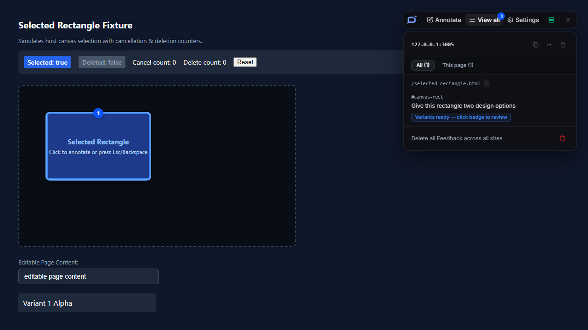

# Issue #25 verification

## Scope and confirmed acceptance seams

Implements the extension/browser-to-MCP slice of [#23](https://github.com/luxi78/vibe-annotations/issues/23) and [#25](https://github.com/luxi78/vibe-annotations/issues/25). Work began on `issue/25` from integration commit `94a933b`; integration `13469fd` was merged before delivery. Testing uses the already confirmed extension UI → isolated local service → real MCP client boundary, plus existing behavioral regression seams.

## Identity and isolation

The extension retains the approved Feedback Window mark and current layout. Product messages and visible record terminology use Pinvelto and Feedback. DOM hosts/classes/attributes, generated element IDs, page bridge globals/events, runtime message actions, and cross-frame session identities use independent Pinvelto names. The page API is `window.__pinvelto` with Feedback-oriented methods; the old page global is absent.

Feedback, settings, screenshots, toolbar preferences, enabled sites, tombstones, and synchronization state use independent storage keys. No migration runs. The real browser acceptance fixture seeds upstream-like `annotations`, `settings`, `vibeToolbarCollapsed`, and `screenshotEnabled` values, creates new Pinvelto Feedback, and reads the old values back unchanged. Its visible list contains only the new record.

Service discovery defaults to port 3847 and requires `product: "pinvelto"` with healthy status. Data operations verify product identity before HTTP requests; a generic healthy service is insufficient. The runtime `pinveltoServiceUrl` setting supports isolated local endpoints. Upstream upgrade banners, automatic release notices, and registry-upgrade status prompts were removed; installed version information remains. Built-in snippets use the local artifact, new MCP name/tools, and port 3847. Full installation-content conversion remains #28's scope.

## Red → Green evidence

- The connection-discovery test initially returned connected for a real foreign HTTP service responding with generic/upstream health. It failed `true !== false`; after product verification it passes.
- The storage-isolation test initially loaded the old upstream record through the existing API boundary. It failed against an expected empty fresh result; after independent keys it passes and ignores old settings.
- Browser acceptance ran the real new workflow while integrating the harness. Initial failures exposed a self-messaging fixture setup error, the MCP image summary intentionally omitting transport attachment IDs, and the need to exit Annotate selection before opening View all. These fixture mistakes were corrected without changing the product workflow or relaxing acceptance assertions.
- The full browser regression run exposed accidental renaming of Playwright's own `test.info().annotations` field and identity-health omissions in existing purge/capture HTTP stubs. Restored the framework field and supplied the explicit new identity at those controlled external boundaries; retained all existing outcome assertions.

## Automated results

- `pnpm --filter vibe-annotations-extension test:unit`: **200 passed, 0 failed**. This includes all 198 prior behavioral checks plus two new identity/storage checks.
- `node packages/extension/tests/run-e2e.js`: **69 passed, 0 failed** in approximately 1.8 minutes. The suite includes actual extension entry and brand, keyboard/focus/IME/session recovery, static/dynamic/runtime injection, cross-frame sessions, pin discovery, design controls, review continuity/filter/count/deletion, screenshot/attachment behavior, settings/docs continuity, and the two new integrated/foreign-service acceptance tests. The intentionally historical keyboard baseline remains a separate command.
- `pnpm --filter vibe-annotations-extension build`: production build succeeds. A separate artifact audit found default `http://127.0.0.1:3847` in its worker and no controlled fixture default `http://127.0.0.1:3005`.
- `git diff --check`: clean.

The build/test runner deliberately separates normal `.output/chrome-mv3` from `.output-e2e/chrome-mv3`. Only the acceptance build contains the controlled initial endpoint and marker. The worker never depends on page request routing for isolation. The harness owns its fixture server, fresh profile, ephemeral service port, temporary home, spawned service, and MCP client; no maintainer service or agent configuration is accessed.

## Real browser → service → MCP proof

The test captures an actual PNG screenshot of the fixture rectangle and attaches it through the real editor's file control. The thumbnail decodes wider than one pixel. After saving, a real MCP client observes server identity `pinvelto` and exactly seven branded tools, rejects `read_annotations`, lists the persisted Feedback, and reads its actual attachment file. The attachment bytes equal the captured screenshot; the real HTTP attachment endpoint returns the same bytes. MCP supplies a Variants-ready lifecycle update and the extension's ordinary background synchronization visibly adds the ready chip to View all. This update proves synchronization; generation and finalization of project code remain #26's separate acceptance.

The foreign-service test uses an actual temporary HTTP server. Its healthy upstream response leaves Pinvelto offline; a user can retain local Feedback, while the foreign server receives only GET `/health` probes and no Feedback mutations.

## Visual evidence

Inspected the loaded browser result: the approved blue mark is visible in the toolbar, the Feedback count is one, View all preserves the existing layout, the comment remains readable, and the MCP-produced Variants-ready chip is visible. The global deletion footer uses Feedback terminology. The screenshot is retained in the repository rather than relying on disposable test-results output.

## Handoff

#26 can reuse `tests/e2e/fixtures.js` with `realService: true` and `tests/e2e/pinvelto-service.js` for generated-project fixtures and export/Variants lifecycle acceptance. Extension exports/markers already received independent identifiers during this slice; #26 must establish and verify its final new export schema, sharing/import behavior, generated-code markers, chosen finalization, and discarded cleanup. #28 still owns package renaming, complete internal website/help/install conversion, and final distribution acceptance. The package filter remains `vibe-annotations-extension` until #28 renames it. The added MCP SDK devDependency changes only the extension importer in the lockfile.
